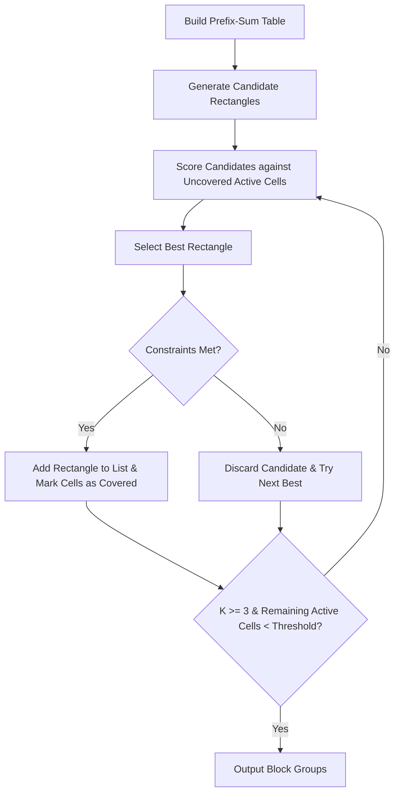

# Key Feature: Block Group Extraction Engine

The **Block Group Extraction Engine** is a core technical component of the Finnomena Asset Matrix Pattern Builder. It bridges the gap between a pixel-based raster grid painted by the user (or procedurally generated) and structured, vector-editable layout shapes in Figma.

---

## 1. Problem Statement

When designers create grid/pixel art or abstract column patterns, they usually want to import them into Figma not as hundreds of individual tiny square layers (which would bloat the Figma document and make editing a nightmare), but as a clean, minimal set of **3 to 6 overlapping bounding rectangles** (Block Groups) that capture the composition's primary shape boundaries.

Manually grouping tiles into optimal rectangles is tedious. The **Block Group Extraction Engine** automates this by executing a greedy rectangle-covering algorithm in real-time.

```
+---+---+---+             +---------------+
| X | X | X |             |               |
+---+---+---+   greedy    |  Rectangle 1  |
| X | X |   |  extraction |               |
+---+---+---+  ---------> +-----------+---+
| X |   |   |             |  Rect 2   |
+---+---+---+             +-----------+
```

---

## 2. Core Constraints

To maintain clean aesthetics and ensure Figma compatibility, the extraction engine operates under strict structural rules:

| Constraint | Value / Rule | Rationale |
|---|---|---|
| **Group Count ($K$)** | $3 \le K \le 6$ | Too few rectangles fail to capture complex structures; too many clutter the Figma layer tree. |
| **Layer Overlap Depth** | $\le 2$ layers per cell | A single grid coordinate can be covered by at most 2 overlapping rectangles. |
| **Exclusivity** | $\ge 1$ exclusive cell per rect | Every extracted rectangle must cover at least one grid cell that is not covered by any other rectangle. |
| **Grid Boundary** | Must align with active cells | Rectangles cannot contain entirely empty regions unless allowed by small tolerance thresholds. |

---

## 3. Algorithm & Implementation Details

The engine utilizes a greedy search algorithm combined with an **Integral Image (Prefix-Sum Table)** to evaluate potential rectangles in $O(1)$ constant time.

### 3.1 Integral Image Acceleration
To quickly check if a candidate rectangle $[x_1, y_1] \to [x_2, y_2]$ covers active/inactive cells without looping through every pixel, a 2D prefix-sum table $S[x, y]$ is built:
$$S[x, y] = \text{active}(x,y) + S[x-1, y] + S[x, y-1] - S[x-1, y-1]$$

Using this table, the number of active cells in any candidate rectangle is computed instantly:
$$\text{ActiveCount} = S[x_2, y_2] - S[x_1-1, y_2] - S[x_2, y_1-1] + S[x_1-1, y_1-1]$$

### 3.2 Scoring Function
Candidates are evaluated using a multi-objective scoring formula:
$$\text{Score} = \text{UncoveredActiveCells} - (1.5 \times \text{InactiveCellsCovered})$$

This formulation:
1. **Rewards** covering active cells that haven't been claimed by prior rectangles.
2. **Penalizes** covering empty/inactive background cells (to prevent large rectangles from introducing unwanted filler shapes).

### 3.3 Greedy Extraction Pipeline



---

## 4. Figma Vector Export Integration

Once the block groups are extracted, the builder generates SVG markup. Rather than exporting raw path coordinates, it maps each block group to an SVG `<rect>` element with absolute positions, dimensions, and styling tags.

When the SVG is copied via the **Async Clipboard API**, the application writes two MIME formats simultaneously:
*   `text/plain`: Raw SVG source code.
*   `text/html`: The SVG embedded in HTML wrappers, which **Figma recognizes as a clipboard object** and converts into native, fully-editable Vector Frames and Rectangles on paste (`Cmd + V`).
